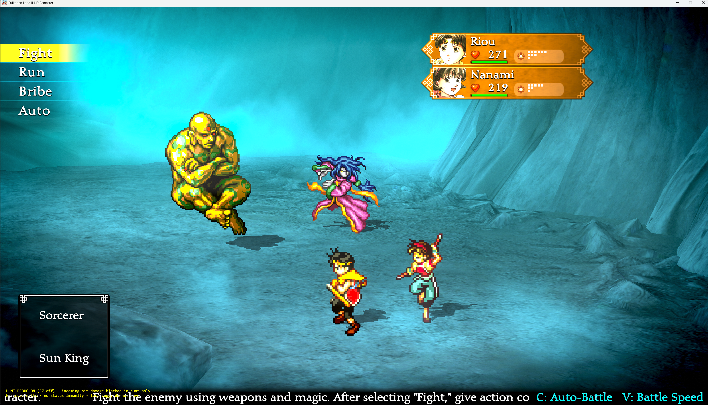

# Suikoden II: Reforged Nightmare

The v1.27 development candidate expands boss tactics and corrects regular-enemy
targeting. See [boss expansion and verification](docs/BOSS-EXPANSION-V127.md).

**A familiar world. More demanding battles. A reason to go hunting.**

An unofficial Windows Steam gameplay overhaul and expansion for **Suikoden II HD
Remaster**, using the original RPG and tactical war engines, artwork, animations,
maps and interfaces. Normal is the intended difficulty foundation. Optional
hunting rewards preparation and grinding without becoming mandatory.

**Pre-publication beta preparation. Overall campaign: experimental.**
The **v1.26 gameplay candidate** packages the verified v1.25 Hunt Catalogue DLL. See the [protected acceptance guide](docs/HUNT-ACCEPTANCE-V126.md). The recommended first
beta is based on the **v1.12.2 Castle Hunt Guild DLL**, which has stronger exact-
binary gameplay evidence. Public review copies remove a personal PDB build path
from debug metadata only. They have new hashes and no exact-hash gameplay
acceptance. Candidate A now passed an isolated startup smoke test with the original
launcher observed; no hunt was played on its public hash. Originals remain preserved.
No public release is approved or published.
[Compare both candidates](docs/RELEASE-CANDIDATES.md).

## What changes

- **80 character profiles** and **31 spell adjustments** for more build choices.
- **280 regular enemy profiles** and **51 remixed formations**, with guarded native
  action/target selection, damage, healing and encounter changes.
- Refined Pest Rat/first Harpy decisions; optional Lucia/final Neclord policies
  remain native-only. Luca’s three original encounters have a native selector baseline. Live tactics remain unavailable. [Manager ownership audit](docs/LUCA-MANAGER-OWNERSHIP-V124.md).
- **Six physical rune** and **eight Unite** improvements.
- Victory rune regeneration: one missing charge per eligible survivor, starting
  at the lowest depleted spell level by default.
- A real **Hunt Guild attendant inside Leona's tavern** in the audited castle variant.
- Voluntary contracts, original-engine battles, repeatable Potch and guarded item
  rewards. Accept, travel, hunt, return and report without developer hotkeys.
- Original-engine story-war unit, AI and objective modifications.

Experimental Castle War Training uses the stock field-to-war transition in a
controlled test copy. Standard War 1 was played twice on v1.29 and Fort Defense
(War 2) completed once on v1.30. See [War Training](docs/WAR-TRAINING-V130.md)
for opt-ins and verification. Commander XP, persistent army training and the
retired Unity arena are unavailable. The beta does not include Castle War Training.

## Start here

1. Read [INSTALL.md](INSTALL.md) for the exact supported game and loader.
2. Install the reviewed installation ZIP while closed; use **Normal**.
3. Begin an experimental campaign or use a backed-up compatible save.
4. At headquarters, visit [the Hunt Guild](HUNT_GUILD.md). Ordinary contracts need
   no F6, F10 or Ctrl shortcut. Loading/restarting clears session-only contracts.

Players need no Codex, Visual Studio or developer script. GitHub's Code ZIP is
source, **not** the installation package.

## What has actually been played

On **1.12.2-guild-ui.1**, a protected user-controlled Normal session demonstrated
Sun King's Retinue: NPC interaction, readable selection, automatic Cave encounter,
two genuine victories, native Stone of Power receipt, rune recovery, field return,
report-back and repeat entry. The second reward actually credited **3,478 Potch**;
the first met the native money cap.

That evidence belongs to DLL SHA256:
`0B520FDD9182B6C024FE96376D0F284BE249DF93AF2E748DC331D21324910F46`.
It does not certify the whole campaign or later development-build gameplay. Dreamer's Circuit and
Thornwake Patrol are native-tested prototypes, disabled in the proposed defaults.
[Exact-build evidence](docs/ACCEPTANCE.md).

## A look at the hunt

*Historical user-supplied hunt-debug screenshot. Damage protection was ON. This
illustrates the engine, not fair balance or acceptance of either candidate DLL;
its exact DLL identity is not independently recorded.*

[Historical reward screen and pending captures](docs/media/README.md).
No synthetic mockup is presented as gameplay proof.

## Documentation

[Features](FEATURES.md) · [Configuration](CONFIGURATION.md) · [Hunt Guild](HUNT_GUILD.md)
· [Known issues](KNOWN_ISSUES.md) · [Changelog](CHANGELOG.md)
· [Building](BUILDING.md) · [Contributing](CONTRIBUTING.md) · [Credits](CREDITS.md)

Original mod code is **MIT-licensed**, approved by the owner. External notices are
retained in [licenses](licenses); see [THIRD_PARTY_NOTICES.md](THIRD_PARTY_NOTICES.md).
No game binaries, loader, generated interop, extracted assets or saves are supplied.
Screenshots depict proprietary game content and are not relicensed as mod code.
This unofficial project is not affiliated with or endorsed by KONAMI.
