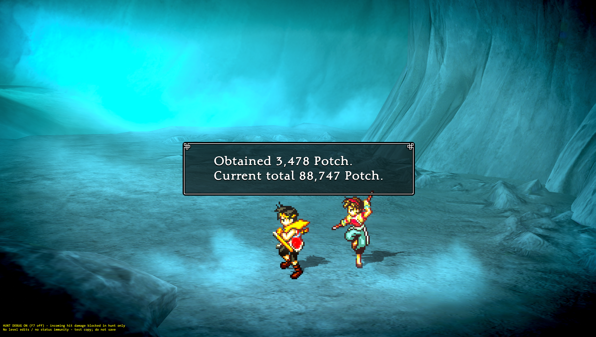

# Genuine images and pending captures

These PNGs are original user-supplied captures from historical hunt-debug work,
not extracted sprites or synthetic previews. Visible damage protection is kept.
Their exact DLL identity is not independently recorded; they do not prove either
candidate's acceptance or difficulty. Screenshots depict proprietary game content
and are not licensed as original MIT mod code.

The screen displays 3,478Potch. That alone does not prove net currency credit;
the later exact v1.12.2 acceptance ledger records the actual purse delta.

Pending genuine captures, deliberately not replaced by mockups:

- [ ] Guild attendant in the audited Leona tavern.
- [ ] Redesigned Guild screen without private desktop content.
- [ ] Original tactical war gameplay, with build/scenario recorded.

No additional gameplay session is requested for these presentation placeholders.
